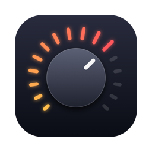

<p align="center"></p>

<h1 align="center">Crescendo</h1>

<p align="center">Control your Audient iD14 MKII with your Mac's volume keys.</p>

---

macOS can't change the volume of an Audient iD14 MKII. Press a volume key and you get the crossed-out
speaker, because the interface tells macOS it has no volume control. Audient's iD app doesn't add one
either.

Crescendo fixes that. It's a tiny background app that catches the volume keys while the iD14 is your
output and turns the interface's own monitor volume, the same one the big knob controls.

- **Volume up / down** in 16 steps, like the built-in volume keys.
- **Mute** toggles the monitor mute.
- **An on-screen volume bar** shows the level on every press.
- **Remembers your volume** when you unplug the iD14 and plug it back in.
- **Leaves everything else alone.** No virtual audio device, no rerouting: your audio still goes
  straight to the iD14. With any other output selected, the keys work as normal.

## Install

1. Download `Crescendo-x.y.dmg` from [Releases](../../releases), open it and drag Crescendo to
   Applications.
2. Open Crescendo. The build isn't notarised by Apple, so macOS blocks the first launch: go to
   **System Settings → Privacy & Security**, scroll down and click **Open Anyway**.
3. Allow Crescendo under **System Settings → Privacy & Security → Accessibility**. It needs that to
   see the volume keys.

That's it. Crescendo runs without a Dock or menu bar icon and starts at login (you'll find it under
**System Settings → General → Login Items**).

## Requirements

- An **Audient iD14 MKII** (USB product ID `0x0008`). Other iD models aren't supported yet.
- macOS 13 Ventura or later, Apple Silicon or Intel. Tested on macOS 27.

## How it works

The iD14 MKII is a USB audio class device. Its monitor section answers vendor-specific class requests
that macOS's own audio driver never uses. Crescendo sends those requests through IOKit to the
interface's spare DFU interface, which no driver claims, so playback is never interrupted.

| What           | Request                                                          |
| -------------- | ---------------------------------------------------------------- |
| Monitor volume | unit `0x36`, selector `0x12`, int16 in 1/256 dB (`0x8000` = off) |
| Monitor mute   | unit `0x36`, selector `0x04`, 1 byte                             |

Safety: before every change Crescendo reads the current level, so a knob turn is never overwritten,
and it never sets the level above 0 dB, the knob's own maximum.

The protocol was reverse engineered by the Linux projects [MixiD](https://github.com/TheOnlyJoey/MixiD),
[BiD](https://github.com/baakhoff/BiD) and [Monix](https://github.com/sKuhLight/monix). Crescendo
wouldn't exist without their work.

## Build from source

Needs the Xcode command line tools (`xcode-select --install`).

```sh
./build.sh      # build/Crescendo.app and build/Crescendo-<version>.dmg
./install.sh    # builds, then installs to /Applications and starts it
```

Builds are signed ad-hoc, so macOS asks for the Accessibility permission again after every rebuild.
Sign with your own certificate to keep it: `SIGN_IDENTITY="Apple Development: Your Name" ./install.sh`.

`Crescendo --read` prints the current monitor volume and mute state, handy to check that your iD14
is reachable:

```sh
/Applications/Crescendo.app/Contents/MacOS/Crescendo --read
```

## Uninstall

1. Quit Crescendo in Activity Monitor.
2. Remove it from **System Settings → General → Login Items** and **Privacy & Security → Accessibility**.
3. Delete `/Applications/Crescendo.app`.

## License

MIT. Crescendo is an independent project, not affiliated with or endorsed by Audient. Audient and iD14
are trademarks of Audient Ltd.
